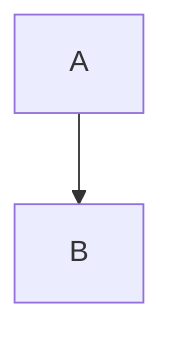

# CLAUDE.md

This file provides guidance to Claude Code (claude.ai/code) when working with code in this repository.

## Project Overview

This is a personal website built with Astro and themed after TUIs (Text User Interfaces). The site features blog posts, projects, research notes, and an RSS feed. It's deployed to Cloudflare Workers.

## Development Environment

This project uses [mise](https://mise.jdx.dev/) for managing development tools. The mise configuration is in `mise.toml`.

### Initial Setup

```sh
# Install mise (if not already installed)
curl https://mise.run | sh

# Install project dependencies
mise install
```

### Writing Scripts with Bun

This project uses Bun as the runtime for scripts in the `scripts/` directory. Before adding new dependencies for common tasks, check if Bun has built-in support:

- **YAML**: Import with `import { YAML } from "bun";` and use `YAML.parse()` and `YAML.stringify()` instead of external YAML libraries
- **File operations**: Bun's `node:fs` has enhanced performance
- **Testing**: Bun has built-in test runner, though this project uses Vitest
- **HTTP**: `fetch()` is built-in
- **SQLite**: `bun:sqlite` is built-in

Always prefer Bun's built-in APIs over adding new npm dependencies. Check the [Bun documentation](https://bun.sh/docs) for available built-in modules.

## Common Commands

All development commands should be run through mise:

```sh
# Start development server (runs on localhost:4321, projects use Desk fixture data)
mise run dev

# Development server against prod Desk through a remote binding (needs wrangler login)
mise run dev:desk

# Build for production
mise run build

# Preview production build
mise run preview

# Format code with Prettier
mise run fmt

# Lint code with oxlint
mise run lint

# Lint and auto-fix issues
mise run lint:fix

# Run tests
mise run test

# Run tests with UI
mise run test:ui

# Ensure content files have codes in frontmatter
mise run gen-codes

# Generate URL manifest mapping slugs to codes
mise run gen-url-manifest

# Deploy subdomains, the wildcard service and the router (not the site Worker; see Deployment)
mise run deploy
```

## Architecture

### Content Collections

The site uses Astro's content collections with file-based loaders defined in `src/content.config.ts`:

- **blog**: Blog posts in `src/content/blog/` with title, description, date, tags, and draft status
- **projects**: Long-form prose for projects in `src/content/projects/`. Project data (name, description, state, links) comes from Desk at request time; see Projects below
- **research**: Research notes in `src/content/research/` with draft/published/archived status and topics
- **pages**: General pages in `src/content/pages/` (including the homepage)
- **devtools**: External RSS feed from devtools.fm podcast

### MDC Syntax Support

The site uses MDC (Markdown Components) syntax from Nuxt Content, converted to MDX via a custom remark plugin (`src/plugins/remark-mdc-to-mdx.ts`). This enables component usage in markdown:

- `::card` → block component
- `:icon` → inline component
- `[text]{.class}` → span with class
- Component attributes can be bound with `:attr="frontmatter.path"`

The plugin automatically imports components from `src/components/` based on usage.

### Mermaid Diagrams

The site supports beautiful ASCII art rendering of Mermaid diagrams using the beautiful-mermaid library. Write mermaid diagrams using standard code fences:



At build time, the `remark-mermaid-ascii` plugin automatically converts Mermaid code blocks into ASCII art using Unicode box-drawing characters. This happens during the MDX processing pipeline before the content is rendered.

See `docs/mermaid.md` for full documentation including Zed editor syntax highlighting configuration.

### File Naming Convention

Content files use simple slug-based filenames: `{slug}.mdx`

Every piece of content has a short code, a unique identifier:

- Kind prefix: `b` (blog), `g` (games), `r` (research), `p` (projects), `t` (talks)
- Hex date: 4-character lowercase hex count of days since 2000-01-01 UTC
- Format: `{kind}{hex-date}` (e.g., `b232e`)

Blog posts, games, research and talks keep their code in a `code` field in frontmatter, derived from the `date` field; `mise run gen-codes` adds any that are missing. Example: `building-a-deno-desktop-framework.mdx` with `code: b232e`.

Project codes are owned by Desk, not MDX: each Desk project has a permanent `code` (`^p[0-9a-f]{4}$`) that is never reused. The projects schema rejects `code` in frontmatter, and gen-codes skips projects. Until Desk's `listPublicProjects()` returns `code`, the 7 projects that used to have MDX codes fall back to `FALLBACK_PROJECT_CODES` in `src/utils/projects.ts` (remove it once Desk ships the field).

### URL Routing & Manifest

The site implements permanent short code URLs. For each content item:

- **Canonical URL**: `/{collection}/{slug}` (e.g., `/blog/apis-in-the-age-of-ai`)
  - Simple slug-based URL generated by Astro
  - This is the primary URL shown in browsers
- **Short code URL**: `/{code}` (e.g., `/b2405`, case-insensitive) → redirects to canonical
  - Provides short, permanent URLs based on content codes
  - Blog, research, talk and game codes are looked up in the URL manifest (301)
  - Project codes (`/p2530`) resolve at request time through Desk: the public Desk project with that code redirects (302) to `/projects/<slug>`, the slug the projects join picks (`projectCodePath` in `src/utils/projects.ts`). If Desk is unavailable, the fallback codes still resolve for the MDX projects.

The URL manifest (`src/content/url-manifest.yaml`) maps non-project content codes to their slug-based URLs and is:

- Generated before each build via `mise run gen-url-manifest` (it skips projects and prunes any project codes)
- Loaded as an Astro content collection using Bun's native YAML parser
- Used by middleware (`src/middleware.ts`) to redirect short code URLs
- Structured with codes as keys and arrays of slugs as values (supports multiple slugs per code)

This ensures permanent short URLs never break, while keeping canonical URLs clean and slug-based. A code's canonical page is its newest manifest path under the code's collection; other paths for the code (frontmatter `slugs`) are aliases that redirect to it (`src/utils/url-manifest.ts`). Project `slugs` aliases (e.g. `/pex`) aren't in the manifest: the middleware reads them from the project MDX and redirects to `/projects/<file name>` (`projectAliasPath`).

### Projects

Desk (desk.just-be.dev, `~/Code/thoughtflow`) is the system of record for projects: short code, name, description, state (`idea | active | maintenance | done | archived`), the `experimental` flag, visibility and links. The site keeps only the long-form MDX prose.

- `/projects` and `/projects/[slug]` render on demand. `src/utils/site-projects.ts` calls `listPublicProjects()` on Desk's private API Worker (its default entrypoint) through the `DESK` service binding in `wrangler.toml`, and joins the result with the MDX by each Desk project's `site` link (`src/utils/projects.ts`).
- MDX frontmatter has only optional overrides (`title`, `description`, `date`) and `slugs` aliases. Don't add `code`, `status`, `url` or `repository`; the schema rejects them, and they belong in Desk.
- Public Desk projects without MDX get a minimal page. MDX whose project isn't public in Desk is hidden. `idea` projects aren't listed.
- Desk answers are cached per isolate (`src/utils/desk.ts`). If Desk is down, pages render MDX only, without state, and never fail.
- `mise run dev` uses fixture data (`src/utils/desk-fixture.ts`); `DESK_DEV=unavailable` in `.dev.vars` simulates an outage.
- `::readme{repo=...}` embeds a GitHub README fetched from raw.githubusercontent.com (never the rate-limited REST API) and cached with stale-on-error (`src/utils/github-readme.ts`).

See `docs/projects.md` for the full rules.

### Styling System

The project uses a custom UnoCSS configuration (`uno.config.ts`) that integrates with WebTUI CSS variables:

- **Spacing**: Uses `ch` (character width) for horizontal and `lh` (line height) for vertical spacing
- **Colors**: Maps to WebTUI CSS variables (e.g., `var(--foreground0)`)
- **Custom rules**: `px-1` = 1ch padding, `py-1` = 1lh padding, etc.
- **Custom variants**: `hocus:` (hover + focus), `group-hocus:`

### Keyboard Shortcuts

The site includes a client-side keyboard shortcut system (`src/client/keyboard-shortcuts.ts`) that:

- Finds elements with `data-key` attributes
- Binds global keyboard shortcuts
- Ignores shortcuts when typing in inputs or when meta key is pressed
- Can be refreshed via `window.refreshKeyboardShortcuts()`

### Site Header and Microfrontends

`src/components/Nav.astro` renders the header (tabs, branding, social links; tabs move to a bottom bar below `lg`) into a declarative shadow root. The same component is published as an HTML fragment at `/fragments/header/`, which the router (`services/router`) injects into microfrontends mounted under `just-be.dev`, currently Traces at `/traces`. Keep the header self-contained: styles inside its `<template>`, no UnoCSS utilities or inline scripts, and tab data in `src/utils/nav.ts`. Keyboard shortcuts look inside the header's shadow root. See `services/router/README.md`.

### Deployment

The site is deployed to Cloudflare Workers with configuration in `wrangler.toml`:

- Static assets in `./dist`
- `DESK` service binding to Desk's private API Worker (default entrypoint)
- Custom domain: `just-be.dev`
- Observability enabled

The site Worker (`just-be-dev`) is deployed by Cloudflare Workers Builds, the Cloudflare GitHub app: every push to `main` builds and deploys it (the "Workers Builds: just-be-dev" check on the commit), and pushes to other branches upload a preview version without deploying. `mise run deploy` does not deploy the site Worker; it covers the subdomains, the wildcard service and the router (`services/router`), which sits in front of the site on `just-be.dev/*`.

## Code Organization

- **src/pages/**: Route pages (dynamic routes for blog, projects, research)
- **src/components/**: Reusable Astro components
- **src/layouts/**: Page layout templates
- **src/content/**: MDX content files organized by collection
- **src/plugins/**: Custom remark plugins
- **src/utils/**: Utility functions (code generation, date formatting)
- **src/client/**: Client-side JavaScript
- **scripts/**: Build scripts and utilities

## Git Hooks

Lefthook is configured (`lefthook.yml`) to run Prettier on staged files before commit. It's automatically installed via mise postinstall hook.

## Testing

The project uses Bun's built-in test runner. Tests are located in `*.test.ts` files alongside the source code.

## Writing Style

### No Emojis

Do not use emojis in README files, documentation, code comments, or any other project files. Keep all written content professional and text-based. This applies to:

- README.md and other documentation files
- Code comments
- Commit messages
- Configuration files
- Content files (blog posts, pages, etc.)

Use clear, descriptive text instead of emojis to convey meaning.
