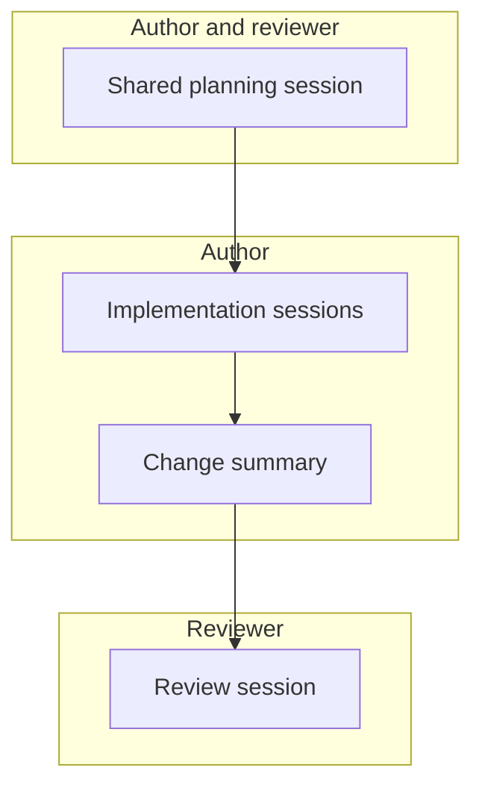

Pull requests have felt off to me lately. Opening one feels a little hollow, and reviewing one feels worse. I think it's because there are agents sitting in the middle of the process now, and nobody can see what they did.

It's easiest to see from both sides of the PR.

## The author

The author used agents to write most of the code. Maybe they spent hours going back and forth, rejecting approaches and steering. Maybe they typed one prompt and opened the PR. From the outside those two look identical. The diff doesn't tell you which one happened.

Unless the author writes some of their own thoughts in the PR body, the reviewer has no idea how much effort went into it. The author can help here by writing the description by hand, or by doing a clear self-review that calls out the parts they thought hard about (and the parts they didn't). That at least signals a human was involved. Still, the reviewer can't see the session where the real work happened, so they don't have much else to go on.

This is new. Code used to _be_ someone's thoughts. A good description always mattered, but even without one you could read how someone approached the problem. What they named things, what they pulled out into an abstraction, where they cut corners. You'd get a pretty good sense of what they were thinking. Generated code doesn't carry that signal in the same way. It reads like the agent's thoughts because it is.

## The reviewer

Most reviewers now have an agent do a first pass. Then maybe (hopefully) they read through it themselves. But they're reading generated code, and they're probably generating most of their own code too. The learning we used to get from review, like seeing how a coworker solves a problem or picking up a pattern you hadn't seen before, happens a lot less.

Then there's the question of how the feedback gets back to the author. If the reviewer has their agent post its comments directly to the thread, the author is likely going to feel alienated. Did the reviewer even look at the PR? Is anyone on the other end?

Having the reviewer rewrite the agent's feedback in their own words isn't great either. It reads more human, but the author still doesn't have the context of the reviewer's session. Whatever the agent found that the reviewer decided not to mention, whatever the reviewer asked it and why, all of that gets lost.

## Sessions are the medium now

Code used to be the medium we learned from. I think now it's sessions. The session is where the decisions get made: the prompts, the dead ends, the "no, not like that." The diff is what's left over.

Right now we throw sessions away. The author's session lives on the author's machine and the reviewer's session lives on the reviewer's. What ends up in the PR is two agents talking past each other with a couple of humans relaying messages between them. It's alienating and isolating. It just feels bad.

We need to change how we do this.

## What I'd try instead

1. **Plan together.** Start with a shared agent session between you and a coworker. Work out the plan with the agent, and keep refining it until you both feel it captures what you actually need.
2. **Implement in the open.** The implementer spins up agents to do the work. Those sessions become artifacts the reviewer can look at later instead of disappearing when the terminal closes.
3. **Write down what changed.** Plans rarely survive implementation intact. Once the work is done, there's an opportunity to produce a synthesized document about how the plan changed along the way and why.
4. **Spot check.** The reviewer comes through and spot checks the work with the plan, the implementation sessions, and that summary in hand. Their session is viewable too, just like all the others.

Every box in that diagram is something both people can open and read, not just the person who ran it.

Some of the tooling for this already exists, and it's showing up in a few different shapes.

**Shared workspaces.** [Amp](https://ampcode.com/) makes [threads visible to your team](https://ampcode.com/docs/threads) by default, lets teammates [prompt the same thread](https://ampcode.com/docs/collaborate/multiplayer), and shows a linked PR right on the thread when you paste the thread URL into the PR description. [HumanLayer](https://www.humanlayer.dev/) groups the research, planning, implementation, and review sessions for a piece of work into a single [task](https://docs.humanlayer.com/explanation/tasks) that the team can see and comment on. Zed's [Delta](https://delta.dev/) lets teammates [join the same agent thread](https://delta.dev/docs/collaboration/collaborate-thread) and steer it together in real time, and Warp has [agent session sharing](https://docs.warp.dev/agents/local-agents/session-sharing/) that works for third-party agents too.

**Sessions tied to commits.** GitHub's Copilot cloud agent [links every commit to its session logs](https://docs.github.com/en/copilot/how-tos/use-copilot-agents/coding-agent/track-copilot-sessions) so reviewers can trace why a change was made. [Entire](https://github.com/entireio/cli) does something similar for any agent, storing transcripts in git and adding a checkpoint trailer to each commit.

**Sessions linked from a PR.** If you just want to attach a session to a PR, [claudereview](https://claudereview.com/) and Simon Willison's [claude-code-transcripts](https://github.com/simonw/claude-code-transcripts) turn a session into a page you can link from the description.

Now everyone has full transparency. The author can see how the reviewer arrived at their feedback, and the reviewer can see how the code came to be.

Review also gets pulled forward. The important disagreements come up during planning, before anyone spends tokens building the wrong thing. By the time the PR is up, the reviewer isn't evaluating the approach for the first time. They're checking that what got built is what everyone agreed on.

And the humans working together get a chance to learn from each other again. Not so much from each other's code anymore, but from how each other thinks, which is what we were really getting from code all along.
